<table>
  <tr>
    <td valign="middle">
      <h2>Olá, eu sou o Victor Cardoso 👋</h2>
      

        Estudante de Ciência da Computação, no início da graduação e com o objetivo
        de me tornar engenheiro de software no mercado de fintechs 💳
      

      

        Estou construindo meus primeiros projetos e aprendendo na prática. Os
        retornos têm sido muito positivos, e cada projeto me ensina algo novo.
      

    </td>
    <td valign="middle" align="center">
      
    </td>
  </tr>
</table>

## 🚀 Projetos

<!-- Adicione aqui seus projetos, um por linha: --> 
<!-- - **[Nome do projeto](link-do-repositorio)**: uma frase sobre o que ele faz. -->[APP Bom Pastor] (https://github.com/Vcaardoso/App-Bom-Pastor) Aplicativo voluntário para a igreja.
[AmbiPresente] (https://github.com/Vcaardoso/A3---AmbiPresente) Projeto de gamificação ambiental.

## 🛠️ Tecnologias

  
  
  
  
  

## 📫 Contato

  
  
  
  
  

 

<picture>
  <source media="(prefers-color-scheme: dark)" srcset="https://raw.githubusercontent.com/Vcaardoso/Vcaardoso/output/github-contribution-grid-snake-dark.svg">
  <source media="(prefers-color-scheme: light)" srcset="https://raw.githubusercontent.com/Vcaardoso/Vcaardoso/output/github-contribution-grid-snake.svg">
  
</picture>

  

